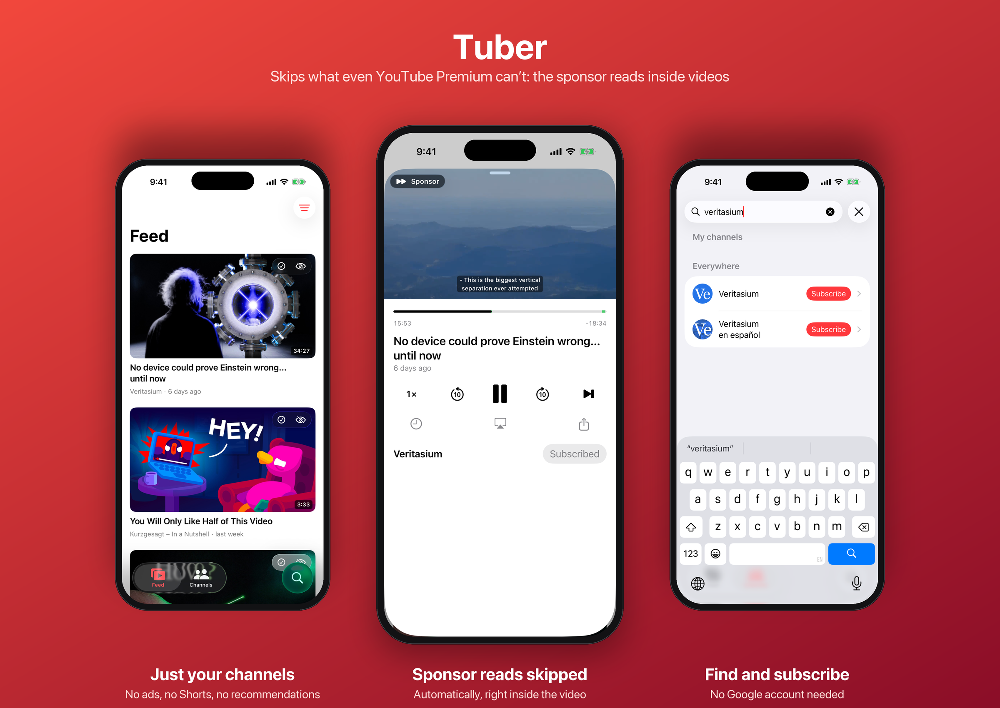
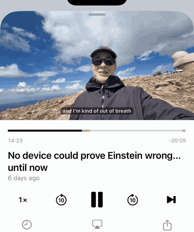

<p align="center">
  
</p>

<h1 align="center">Tuber</h1>

<p align="center">
  <b>Skips what even YouTube Premium can’t: the sponsor reads inside videos.</b><br>
  No ads. No Shorts. No recommendations. Just the channels <i>you</i> choose, in a native iOS player.
</p>

<p align="center">
  
  
  
  
</p>

<p align="center">
  
</p>

> **Personal and educational project.** Tuber is not affiliated with, endorsed by or connected to Google or YouTube.
> It is not distributed as a binary: there is no App Store, TestFlight or .ipa release. If you want it, build it yourself for your own device.

## Why

Two kinds of interruptions get between you and a video:

1. **Ads** that the platform plays before and during a video. Tuber plays the video stream directly, so there are none.
2. **Sponsor reads** that creators record into the video itself: "This video is sponsored by...". Even YouTube Premium makes you sit through them. Tuber skips them automatically using crowd-sourced timestamps from [SponsorBlock](https://sponsor.ajay.app).

<p align="center">
  
  <br><sub>The sponsor read starts at 14:26. Tuber jumps to 15:52 on its own and shows a small “Sponsor” badge.</sub>
</p>

And the official app is built to keep you scrolling. Tuber is built for watching: one feed of only the channels you subscribed to, without Shorts or suggestions.

## Features

- **Sponsor reads skipped automatically.** Sponsor segments, self-promotion and "like and subscribe" reminders are jumped over and marked green on the timeline, with a small "Sponsor" badge when it happens. Pick the categories in Settings.
- **No ads.** The video stream plays directly in a native player.
- **Your channels only.** Subscribe without a Google account. Search channels and videos, or share a link from any app into Tuber.
- **One feed** of all subscriptions, newest first, **no Shorts** anywhere. Infinite scroll loads older videos without the list jumping.
- **Native player** on AVKit: background audio, lock screen and Control Center controls, Picture in Picture, AirPlay.
- **YouTube-style gestures:** double tap left or right to seek 5 seconds, press and hold for 2x, speed menu from 0.25x to 2x.
- **Remembers everything:** playback position per video, watched state, Watch later, hidden videos, "mark all as watched" per channel, channels hidden from the feed.
- **iCloud sync** across your devices through your private CloudKit database.
- **Siri and Shortcuts:** "Continue in Tuber", "Latest video from Veritasium in Tuber", "What's new on Kurzgesagt in Tuber".
- **Import subscriptions** from Google Takeout (`subscriptions.csv`) or a plain text list (see below).
- **English and Russian** UI, Liquid Glass design that follows the system light and dark mode.

## Build it yourself

Requirements: a Mac with Xcode 27 or newer, an iPhone on iOS 26.1 or newer, and [XcodeGen](https://github.com/yonaskolb/XcodeGen) (`brew install xcodegen`).

```bash
git clone https://github.com/skriptoff/Tuber.git
cd Tuber
cp Local.xcconfig.example Local.xcconfig   # put your Team ID and bundle prefix here
xcodegen generate
open Tuber.xcodeproj
```

Select your iPhone and press Run.

- `DEVELOPMENT_TEAM` is your Apple Developer Team ID.
- `BUNDLE_PREFIX` is a reverse-DNS prefix you own, for example `com.yourname`. The bundle ID, App Group and iCloud container are derived from it, and Xcode registers them on the first build.
- A **paid** developer account gives you iCloud sync, the share extension and a signature that lasts a year. With a free Apple ID, remove the iCloud and App Group entitlements from `project.yml`; the app then re-signs every 7 days.

## Import subscriptions

In the app: **Channels → ⚙︎ → Import subscriptions**, then pick a file.

**From YouTube:** at [takeout.google.com](https://takeout.google.com) select only "YouTube and YouTube Music", keep only "subscriptions", export, unzip in Files and pick `subscriptions.csv`.

**Or a plain text list,** one channel per line. Handy if you let an AI assistant prepare it:

```text
# comments start with #
@veritasium
https://www.youtube.com/@kurzgesagt
UCsXVk37bltHxD1rDPwtNM8Q
- @mkbhd          # a leading "-" subscribes without showing the channel in the feed
```

## How it works

| Piece | Source |
|---|---|
| New videos | Public channel RSS feeds |
| Older videos, search, video details | YouTube's public web endpoints, anonymous, no API key |
| Playback | Stream URLs via [YouTubeKit](https://github.com/alexeichhorn/YouTubeKit), played by `AVPlayer` |
| Skip segments | [SponsorBlock](https://sponsor.ajay.app) API |
| Storage and sync | SwiftData with CloudKit (your private iCloud database) |

The project is generated by XcodeGen from `project.yml`. Unit tests cover the pure logic: link parsing, RSS and page parsing, skip and watched rules, import formats.

```bash
xcodebuild test -scheme Tuber -destination 'platform=iOS Simulator,name=iPhone 17'
```

## Limitations

- Depends on unofficial endpoints. When YouTube changes something, playback or search can break until YouTubeKit or the parsing here is updated.
- Age-restricted videos don't play, since there is no sign-in.
- Dates of older videos loaded by scrolling are approximate ("3 months ago").

## Credits

- [SponsorBlock](https://sponsor.ajay.app) by Ajay Ramachandran and contributors. Segment data is licensed under [CC BY-NC-SA 4.0](https://creativecommons.org/licenses/by-nc-sa/4.0/), so Tuber is and must stay non-commercial.
- [YouTubeKit](https://github.com/alexeichhorn/YouTubeKit) by Alexander Eichhorn (MIT).

## Disclaimer

This project is for personal and educational use. It is not affiliated with Google LLC or YouTube. "YouTube" is a trademark of Google LLC and is used here only to describe what the app works with. Using it may conflict with YouTube's Terms of Service; you are responsible for how you use it. Support the creators you watch.

## License

[MIT](LICENSE) for the code in this repository. Third-party data and libraries keep their own licenses.
